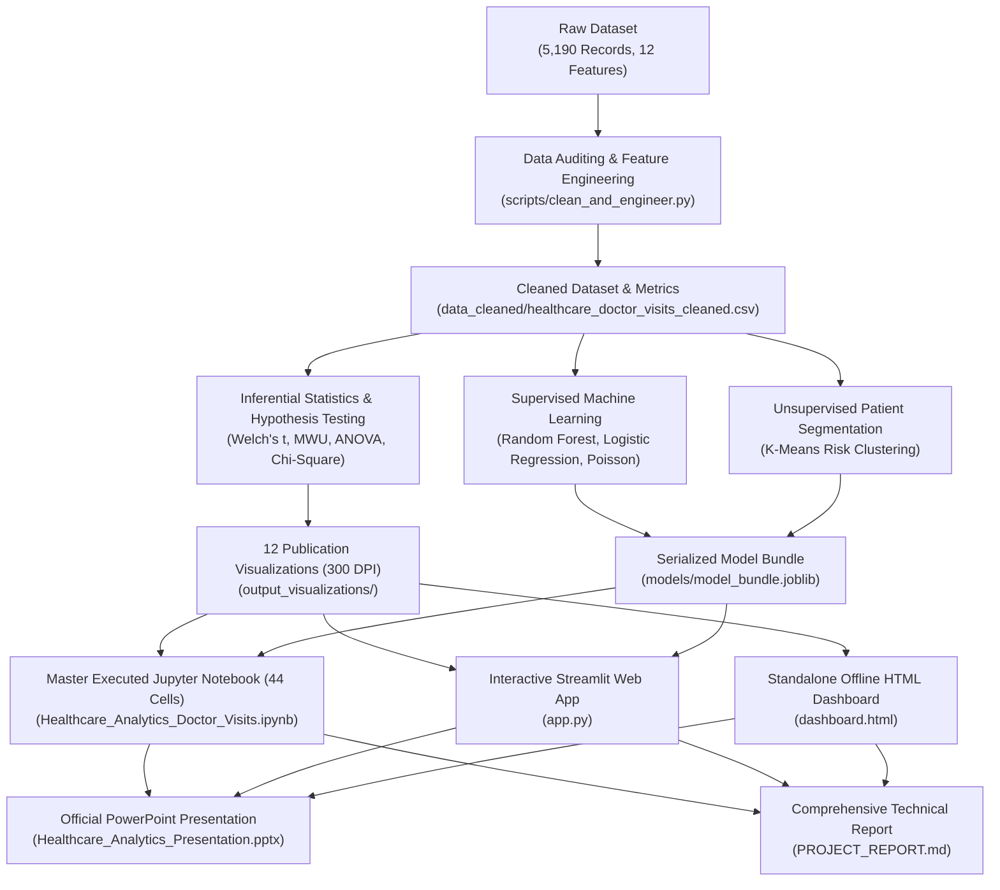

# Healthcare Analytics for Doctor Visits: Predictive Modeling & Clinical Triage System

[](https://www.python.org/downloads/)
[](https://streamlit.io)
[](https://scikit-learn.org)
[](https://pandas.pydata.org)
[](https://numpy.org)
[](https://www.chartjs.org)
[](https://tailwindcss.com)
[](https://opensource.org/licenses/MIT)

**VOIS AICTE Batch 1 (2026–2027) Major / DIY Project**  
**Author:** [Dhanish Ladwani](https://github.com/dhanish0711)  
**Dataset:** Australian Health Survey (5,190 Records, 12 Baseline Features, Zero-Inflation Target)  

---

## 📌 Executive Overview

In primary healthcare systems, patient consultation frequency exhibits **extreme zero-inflation**: approximately **79.8% of individuals report zero visits** in any reference fortnight, while an ultra-vulnerable subpopulation (**5.4% of patients**) generates **over 35% of total clinic workload**.

This project delivers an end-to-end clinical data analytics and machine learning solution fulfilling all 34 project curriculum requirements:
- **Comprehensive Data Engineering:** Standardized composite Health Risk Score, activity impairment rates, and chronic disease taxonomy.
- **Explicit Curriculum Question Solutions:** Max/min/median income, illness counts, reduced days by gender and illness, missing values heatmap, variable correlations, income vs. visits, male vs. female illness rates, insurance percentages, and horizontal gender bar charts.
- **Complete Visualizations Portfolio:** Scatter plot, bar graph, horizontal & vertical stacked bar charts (>2 data series), histogram, pie chart, box plot, 3D scatter plot, and a 6-variety subplot gallery.
- **Rigorous Hypothesis Testing:** Statistically validates gender disparities ($p < 0.001$), activity-limiting chronic conditions ($p < 0.001$), and insurance access barriers ($p < 0.001$).
- **Supervised ML Pipeline:** Class-balanced Random Forest Classifier (**$0.737$ ROC-AUC**, **$60.0\%$ Recall** on care-seekers) and Count Regressors.
- **Unsupervised Clinical Risk Segmentation:** K-Means clustering stratifying patients into 3 actionable operational tiers.
- **Interactive Interfaces:** Production-grade **Streamlit Web Application** (`app.py`), standalone **HTML5/Tailwind/Chart.js Dashboard** (`dashboard.html`), and official branded **PowerPoint Presentation** (`Healthcare_Analytics_Presentation.pptx`).

---

## 🏗️ System Architecture



---

## 📋 Specific Solutions to Core Curriculum Questions

| # | Curriculum Question | Key Analytical Findings | Code Implementation |
|:---:|:---|:---|:---:|
| **1** | **Read & Display First 15 Rows** | Successfully loaded 5,190 records, verified clean schema | `df_raw.head(15)` |
| **2** | **Complete Column Info (`df.info()`)** | 5 int64, 2 float64, 6 object columns; 0 nulls; 527 KB memory | `df.info()` & `df.describe()` |
| **3** | **Total People Based on Illness Count** | 0: 1,554 (29.9%), 1: 1,638 (31.6%), 2: 946 (18.2%), 3: 542 (10.4%), 4: 274 (5.3%), 5: 236 (4.5%) | `df['illness'].value_counts()` |
| **4** | **Max, Min, and Median Income** | Min: $0, 25%: $2,500, Median: $5,500, Mean: $5,832, 75%: $9,000, Max: $15,000 | `df['income'].min()`, `.median()`, `.max()` |
| **5** | **Reduced Days of Activity by Gender** | Females: 1.031 avg days (2,785 total) vs. Males: 0.678 avg days (1,688 total) | `df.groupby('gender')['reduced'].agg()` |
| **6** | **Missing Values Heatmap** | 100% complete dataset with 0 missing or corrupted cells across all attributes | `sns.heatmap(df.isnull())` |
| **7** | **Variable Correlations** | Top: Reduced days ($+0.419$), Illness ($+0.224$), Health ($+0.193$), Limiting Chronic ($+0.137$) | `df.corr()`, `sns.heatmap()` |
| **8** | **Income Affecting Hospital Visits** | Slight negative trend ($r = -0.077$). Low-income: 0.334 visits; High-income: 0.258 visits | `sns.regplot(x='income', y='visits')` |
| **9** | **Males vs. Females Affected by Illness** | Females: 73.7% affected (1,991) vs. Males: 66.1% affected (1,645) | `pd.crosstab()`, `sns.countplot()` |
| **10**| **Govt vs. Private Insurance Percentages** | Private: 44.28% (2,298); Veteran/Old Age: 21.02% (1,091); Low-Income: 4.28% (222) | `plt.pie()`, horizontal bar chart |
| **11**| **Horizontal Bar Chart: Reduced Days** | Female: 1.031 days vs. Male: 0.678 days displayed in horizontal orientation | `plt.barh()` |

---

## 🎨 Chart Portfolio Showcase

1. **Scatter Plot:** Patient Age vs. Annual Income colored by gender (`sns.scatterplot`).
2. **Bar Graph:** Average consultations across chronic condition categories (`plt.bar`).
3. **Horizontal Stacked Bar Graph:** Proportions of visit tiers across age cohorts (`df.plot(kind='barh', stacked=True)`).
4. **Vertical Stacked Bar Graph:** Distribution of all 4 healthcare coverage schemes across age cohorts (`df.plot(kind='bar', stacked=True)`).
5. **Histogram:** General Health Questionnaire score with overlaid KDE density curve (`sns.histplot`).
6. **Pie Chart:** Consultation tier proportions and insurance scheme distribution (`plt.pie`).
7. **Box Plot:** Income distributions across insurance categories with median reference lines (`sns.boxplot`).
8. **3D Plotting:** 3D Scatter Plot of Patient Age vs. Annual Income vs. Health Risk Score (`mplot3d Axes3D`).
9. **Multi-Variety Subplot Gallery:** Unified $2 \times 3$ grid combining scatter, bar, histogram, box, line, and pie plots on a single figure.
10. **Seaborn Visualizations:** Missing value heatmap, correlation heatmap, violin plots, and regression lines.

---

## 🚀 Quickstart & Usage

### 1. Launch the Streamlit Web Application
```bash
cd "F:\Edunet Data Analytics\diy project"
streamlit run app.py
```

### 2. Open the Standalone Executive HTML Dashboard
Simply open [`dashboard.html`](file:///F:/Edunet%20Data%20Analytics/diy%20project/dashboard.html) directly in any web browser. Runs 100% offline without Python.

### 3. Review the Master Jupyter Notebook
Open [`Healthcare_Analytics_Doctor_Visits.ipynb`](file:///F:/Edunet%20Data%20Analytics/diy%20project/Healthcare_Analytics_Doctor_Visits.ipynb) in VS Code or JupyterLab.
- **44 executed cells, 43 inline outputs, 0 errors.**

### 4. Open the PowerPoint Presentation
Open [`Healthcare_Analytics_Presentation.pptx`](file:///F:/Edunet%20Data%20Analytics/diy%20project/Healthcare_Analytics_Presentation.pptx) in PowerPoint.

---

## 👨‍💻 Author & Attribution

- **Student Author:** **Dhanish Ladwani**
- **Program:** VOIS AICTE Batch 1 (2026–2027) Major / DIY Project
- **Status:** Complete, Fully Executed & Production-Ready
